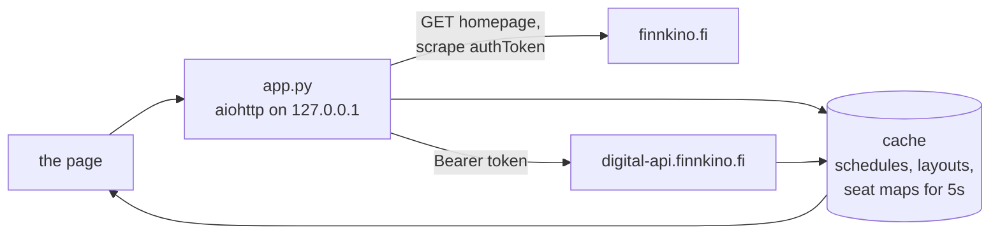

# SeatFlash

Minimal local Finnkino seat-map viewer optimized for speed and minimal clicks.

## Run

```bash
uv venv .venv
uv pip install --python .venv/bin/python -r requirements.txt
.venv/bin/python app.py          # http://127.0.0.1:8799
```

Python 3.11 or newer, on macOS, Linux or Windows. The three dependencies earn their place:
`aiohttp` is the server, `curl-cffi` is what gets past the browser check on Finnkino's homepage,
and `tzdata` exists so `Europe/Helsinki` still resolves on Windows and in slim containers.

First launch backfills today plus six days for every venue in seven batched calls, then preloads
the distinct auditorium layouts with bounded concurrency. `GET /api/cache-status` says how far the
warm-up has got; the seat panel fills in as it completes.

## Layout (v2 — ground-up rework)

One screen, no modes, no hidden panels:

- **Top bar**: day tabs (today + 6), one scope select (All cinemas or any venue, grouped by city), format filter (IMAX / LUXE / iSense / Maxim / 3D / Standard), and `/`-focused movie search.
- **Left**: every film with its showtimes grouped by cinema as two-line chips (time + format). Sold-out shows are struck through. Search and format filters apply instantly.
- **Right**: a permanently reserved seat panel. The first available showtime is auto-selected on load and after every filter change, so the auditorium is never empty; clicking any chip swaps the seat map in one click. A **"7-day grid" toggle** in the panel header flips the panel into a scrollable grid of mini seat maps — one per showtime across the next 7 days, respecting the current cinema/format/search filters. Mini maps load live availability lazily as they scroll into view (IntersectionObserver, 200px lookahead); clicking one opens that show in the single-map view.

Live seat availability is fetched only for the selected show and micro-cached for five seconds so it never becomes misleadingly stale. The auditorium "lights up" with a quick seat stagger on load; reduced-motion is respected. Fonts (Saira Condensed display + Instrument Sans body) are bundled locally in `static/fonts/` — no network requests, offline-safe.

At startup the backend backfills **today plus six days** for every Finnkino location in seven batched API requests, then preloads all unique static auditorium layouts with bounded concurrency. Warm-up state: `http://127.0.0.1:8799/api/cache-status`. Combined daily schedule (all sites) for Movie-style browsing: `/api/movies?date=YYYY-MM-DD`. Individual cinema/day schedules: `/api/schedule`.

No Finnkino bearer token is stored in this repository. The backend obtains the current public website token at runtime.

## How it fits together



The bearer token is the one thing worth explaining. Finnkino hands it to the public website and
the site embeds it in the page config, so the token is public by construction and rotates. The
backend scrapes it at runtime and keeps it in memory, with `TOKEN_REFRESH_MARGIN` set to an hour so
a long-running process refreshes before the API starts refusing. No token is committed, and there
is nothing in this repository to rotate.

Seat availability is the only data that cannot be prefetched, because it changes minute to minute
and each call is an auditorium-sized payload. It is fetched per selected show and cached for five
seconds, which is short enough that a seat taken while you look is unlikely to still read as free.

## Design

Auditorium-ink palette (`#0a0c12`), house-light amber accent, steel-blue projector glow. The old Cinema/Movie toggle and floating seat card are gone — replaced by one unified flow and a fixed seat pane (layout mockups explored in `sketches/`).
